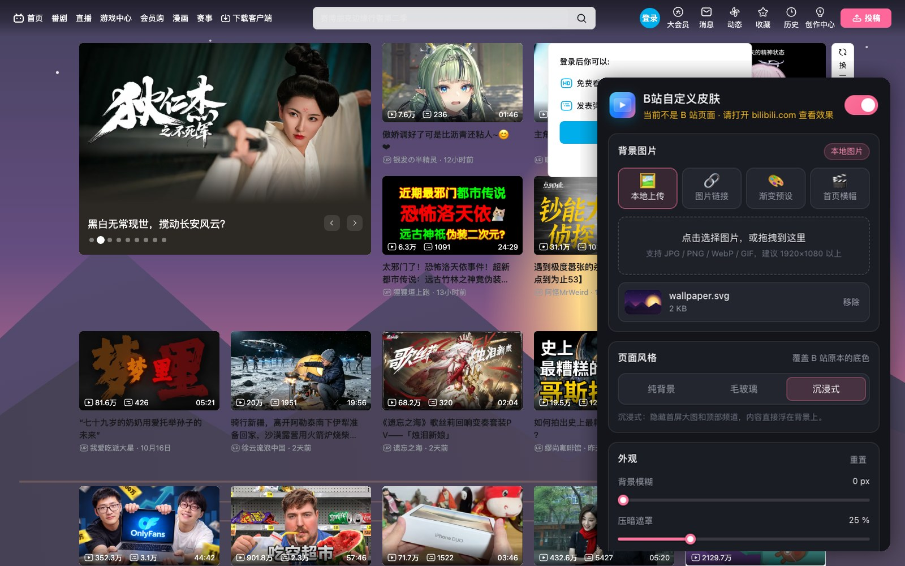
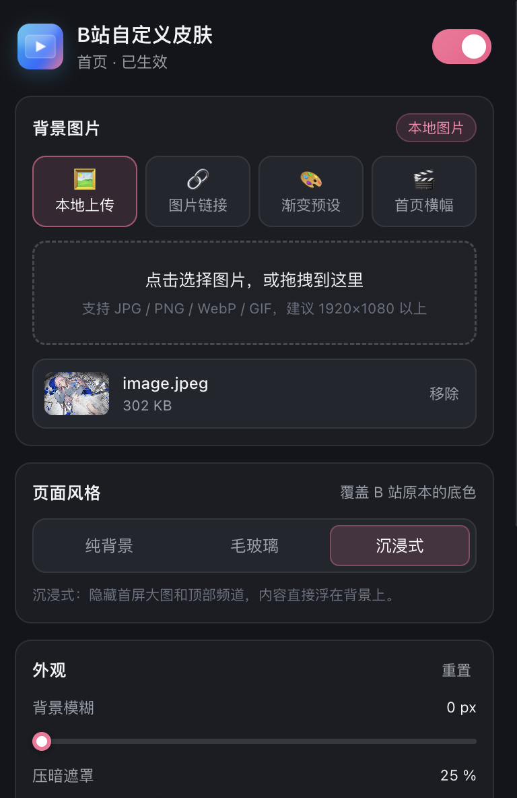

# B站自定义皮肤 · Bili Skin

给网页版 bilibili 换一张背景：自定义图片 / 渐变、毛玻璃卡片、沉浸式排版。全部本地运行，不需要登录、不上传任何数据。

部分代码使用AI。

---

## 功能一览

功能
- 四种背景来源 
- 三种页面风格
- 实时调参
- 深浅色 
- 播放页支持
- 本地保存
- 导入、导出json

  

## 安装

### 方式一：安装为 Chrome / Edge 扩展（推荐）

1. 打开 `chrome://extensions`（Edge 是 `edge://extensions`）
2. 右上角打开 **开发者模式**
3. 将从 **Releases** 下载的.zip压缩文件 拖入 **Extensions** 界面
4. 打开 [bilibili.com](https://www.bilibili.com/)，点击工具栏里的皮肤图标调整设置即可

### 方式二：Tampermonkey 用户脚本

1. 安装 [Tampermonkey](https://www.tampermonkey.net/) 或 Violentmonkey
2. 新建脚本，把从 **Releases** 下载的.js文件 粘贴进去（或将文件拖进浏览器）
3. 打开 B 站，右下角会出现 🎨 小圆点，点开即可调设置

> 此方式不支持本地图片上传，但可以用图片链接和渐变。

## 使用

弹窗从上到下：

1. **总开关**：一键暂停 / 恢复
2. **背景图片**：上传图片 / 粘贴链接 / 点一个渐变 / 抓取首页头图
3. **页面风格**：三选一，改动立刻在当前页面生效
4. **外观**：五个滑杆实时预览，如文字模糊请加「压暗遮罩」
5. **高级设置**：播放页开关、深浅色、顶栏压暗、导入导出

### 设置项说明

**设置**
- 背景模糊
- 压暗遮罩
- 卡片透明度
- 毛玻璃强度
- 填充方式
- 顶栏压暗

## 已知限制

- **播放页的播放器区域**保持 B 站原生黑底，不强行透明（避免影响视频观感）；页面其余部分会透出背景。
- 背景图建议 **1920×1080 以上**；单张上限 20 MB，超过会提示压缩。
- 首页头图可能无法抓取
- 部分图片站点有防盗链，链接方式可能显示空白，改用「本地上传」即可。
- 毛玻璃在较老的显卡/浏览器上可能较重，把「毛玻璃强度」调低或切到「纯背景」可缓解。
- B 站改版时，个别区域的透明化选择器可能需要更新。
- 修改设置后请记得刷新

## 许可证

[MIT](LICENSE)。与 bilibili 官方无关，仅供个人学习与自定义使用。
